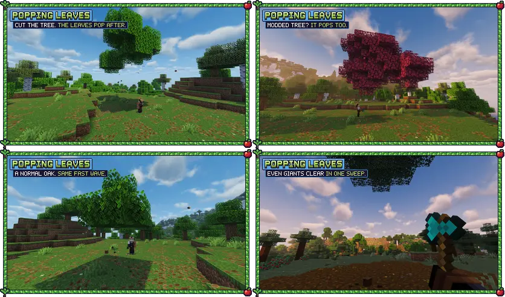

**Tree down. Leaves pop.** Cut a tree and its leaves follow in one fast wave: each leaf snaps out and sprays a few pixel chips, instead of lingering for a minute and vanishing one by one. A mod for Minecraft Java 26.3, 26.2, 1.21.11, 1.21.1 and 1.20.1 on Fabric, Quilt, Forge and NeoForge, with a server half and a client half; either one works alone.

- **Fast ripple decay (server).** Leaves that lost their tree go within a second or two, starting at the cut and spreading outward.
- **The pop (client).** A decaying leaf lets go of a chip, then squashes and shrinks away with a short spray of solid pixels cut from its own texture, in its biome colour, with a soft rustle.
- **Vanilla rules.** Same drops (saplings, sticks, apples), and leaves you placed never decay.
- **Vanilla client, modded server.** The decay is fast, players without the mod just see the leaves vanish.
- **Modded client, vanilla server.** Ordinary decay gets the pop.
- **Big trees.** Capped per tick, so a jungle giant clears without a lag spike.

Install it and fell a tree. Nothing to press and nothing to learn.

Open the settings screen from Mod Menu (optional). It has a master switch for the pop, an intensity from 50 to 150%, **Reduced motion** (smaller movement, one chip per leaf), a rustle sound, the shed chip, and a switch for the fast decay of the world's server. The same settings live in `config/snappy_leaf_decay.json`, which also holds the server numbers (first delay, ripple speed, decays per tick) and every pop timing. Edits are picked up within about two seconds, no restart.

- Works with Sodium and Iris shader packs (tested with Complementary), Fair Weather, Timber and Veinminer on 26.3. On the older versions only vanilla rendering is tested so far.
- Cut by a tree feller or by hand, the leaves follow the same way.
- Modded trees work out of the box if their leaves are built on vanilla's leaf block. Tested with Biomes O' Plenty on Fabric 26.3: 19 of 20 leaf types decay fast, Null Leaves keep their normal speed.
- Other mods that already speed up leaf decay make the server half stand aside, so nothing is doubled.
- With `randomTickSpeed` 0 the server half stands aside too, as vanilla decay would not run either.

Put the jar for your Minecraft version and loader in your `mods` folder. Fabric and Quilt use the Fabric jar and need no other mod (Fabric API is not required); on 1.20.1 NeoForge runs the Forge jar. Install it on the server for the fast decay, on the client for the pop, or on both.

<!-- promo:start -->

<!-- promo:end -->

Popping Leaves is free. If it makes felling trees more fun, a coffee helps fund the next update.

Want your own server to play on with friends? My BisectHosting affiliate link gives you 25% off the first month, and I get a small commission.

All rights reserved; see [LICENSE](https://github.com/ProfetGit/popping-leaves/blob/main/LICENSE).

Made with AI assistance (code, assets, text). Not an official Minecraft product. Not approved by or associated with Mojang or Microsoft.

